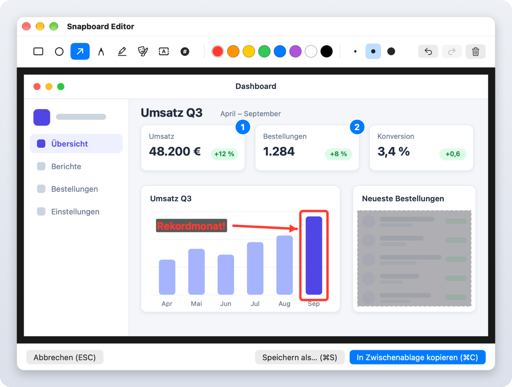
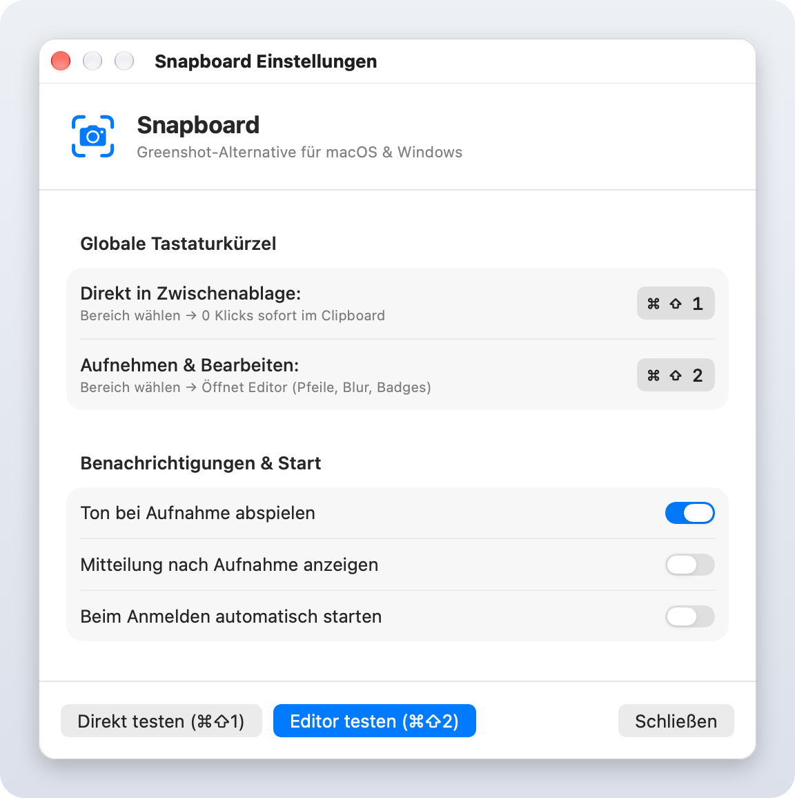

# Snapboard 📸⚡

[](https://github.com/leonatwork/snapboard/actions/workflows/build.yml)
[](https://github.com/leonatwork/snapboard/releases)
[](LICENSE)
[]()
[](https://github.com/search?q=topic%3Ai-love-macos-but-i-miss-windows-features+user%3Aleonatwork&type=repositories)

> The lightweight, privacy-focused Greenshot alternative for **macOS** and **Windows**. 
> Capture screen areas directly to your clipboard — **without saving unnecessary files to disk**.

*🇬🇧 [English version](README.md) — die englische Fassung ist maßgeblich und wird zuerst aktualisiert.*

---

## 🧩 Teil des Pakets

Snapboard ist eines von vier Tools im Paket **[„I love macOS, but I miss some Windows features“](https://github.com/search?q=topic%3Ai-love-macos-but-i-miss-windows-features+user%3Aleonatwork&type=repositories)**:

| Tool | Was es macht | Download |
| :--- | :--- | :--- |
| [**Tappi**](https://github.com/leonatwork/Tappi) | Alt+Tab zwischen Fenstern statt Apps | [Neueste Version](https://github.com/leonatwork/Tappi/releases/latest) |
| [**Klemmi**](https://github.com/leonatwork/Klemmi) | Zwischenablage-Verlauf wie Win+V, mit Quell-App | [Neueste Version](https://github.com/leonatwork/Klemmi/releases/latest) |
| [**Snapline**](https://github.com/leonatwork/snapline) | Snap Layouts, Aero Snap und Snap Assist aus Windows 11 | [Neueste Version](https://github.com/leonatwork/snapline/releases/latest) |
| [**Snapboard**](https://github.com/leonatwork/snapboard) *(dieses Tool)* | Screenshots wie mit dem Snipping Tool, direkt in die Zwischenablage | [Neueste Version](https://github.com/leonatwork/snapboard/releases/latest) |

👉 Dir fehlt mehr als eine dieser Funktionen? Lade dir alle vier herunter und hol dir deine liebsten Windows-Features auf den Mac.

---

## 📥 Download & Installation

Du kannst Snapboard direkt von GitHub herunterladen und ohne Terminal nutzen:

| Plattform | Download | Installation |
| :--- | :--- | :--- |
| 🍏 **macOS** (Apple Silicon & Intel) | [**Download Snapboard-macOS.zip**](https://github.com/leonatwork/snapboard/releases/latest/download/Snapboard-macOS.zip) | ZIP entpacken & `Snapboard.app` in deinen **Programme**-Ordner ziehen |
| 🪟 **Windows** (x64) | [**Download Snapboard-Windows-x64.zip**](https://github.com/leonatwork/snapboard/releases/latest/download/Snapboard-Windows-x64.zip) | ZIP entpacken & `Snapboard.exe` doppelklicken |

👉 Alle Versionen findest du auch unter [**GitHub Releases**](https://github.com/leonatwork/snapboard/releases).

### macOS: Gatekeeper (macOS 15+)

Der macOS-Download ist nicht notarisiert. Deshalb kann Gatekeeper den ersten Start blockieren. Versuche zunächst, `Snapboard.app` aus dem Programme-Ordner zu öffnen. Öffne danach **Systemeinstellungen → Datenschutz & Sicherheit**, scrolle zur Sicherheitsmeldung über Snapboard und klicke auf **„Dennoch öffnen“**. Bestätige den nächsten Dialog und authentifiziere dich, falls du dazu aufgefordert wirst. Öffne Snapboard anschließend erneut.

### macOS: Recht zur Bildschirmaufnahme

Beim ersten Aufnahmeversuch (`⌘⇧1` oder `⌘⇧2`) prüft Snapboard das Recht zur Bildschirmaufnahme. Fehlt es, startet keine Aufnahme: Wähle im Dialog **Systemeinstellungen öffnen**, um direkt zu **Datenschutz & Sicherheit → Bildschirm- & Systemaudioaufnahme** zu gelangen (auf manchen macOS-Versionen **Bildschirmaufnahme** genannt). Aktiviere dort Snapboard. Eventuell musst du Snapboard beenden und erneut öffnen, bevor du das Tastenkürzel wieder verwendest. Das Recht gilt auch für Aufnahmen über das Menü und die Test-Buttons in den Einstellungen.

Mitteilungen sind standardmäßig aus: Beim Start fragt Snapboard nicht nach diesem Recht. Erst wenn du **Mitteilung nach Aufnahme** in den Snapboard-Einstellungen einschaltest, wird es angefragt. Bei Ablehnung geht der Schalter wieder aus und ein Hinweis erklärt, wie du Mitteilungen unter **Systemeinstellungen → Mitteilungen → Snapboard** erlauben kannst.

---

## 🖼️ Screenshots

<div align="center">
  <h3>Snapboard Editor: Pfeile, Formen, Text, Schritt-Badges & Zensieren (⌘ ⇧ 2 / Ctrl + Shift + 2)</h3>
  
  <br /><br />
  <h3>Einstellungen: globale Tastaturkürzel, Ton, Mitteilungen & Autostart</h3>
  
</div>

---

## ✨ Features

- ⚡ **Zero-Click Clipboard Capture**: Bereich auswählen und sofort mit `⌘ V` / `Ctrl + V` in jede beliebige App einfügen.
- 🎨 **Integriertes Bearbeitungsstudio**:
  - ⭕ **Kreise & Ellipsen**
  - ⬜ **Rechtecke & Rahmen**
  - ➡️ **Pfeile**
  - ✏️ **Freihand-Stift**
  - 🖍️ **Highlighter / Textmarker** (halbtransparent)
  - 🌫️ **Zensieren / Blur (Pixelate)**: Unkenntlichmachen von Passwörtern, IBANs, Namen etc.
  - 🔤 **Textfelder**
  - ① **Schrittzähler (1, 2, 3...)**: Automatisch hochzählende Badges für Anleitungen.
- 🛡️ **Kein Festplattenmüll**: Arbeitet direkt im RAM, keine temporären oder dauerhaften Screenshot-Dateien auf der Festplatte.
- 🪶 **Nativ & Leichtgewichtig**: Läuft dezent in der Menüleiste (macOS) bzw. im System Tray (Windows).
- 🚀 **Autostart-Unterstützung**: Mit einem Klick beim Systemstart ausführen.
- 🌍 **10 Sprachen**: Englisch, Deutsch, Französisch, Spanisch, Italienisch, Portugiesisch (Brasilien), Niederländisch, Japanisch, vereinfachtes Chinesisch und Koreanisch. Die macOS-App folgt der Systemsprache (die Windows-App ist derzeit nur auf Deutsch).

---

## ⌨️ Shortcuts

### 🍎 macOS
| Shortcut | Modus | Aktion |
| :--- | :--- | :--- |
| **`⌘ + ⇧ + 1`** | **Direkt-Capture** | Bereich markieren → **Sofort in die Zwischenablage** (0 Klicks) |
| **`⌘ + ⇧ + 2`** | **Capture & Edit** | Bereich markieren → **Öffnet den Snapboard-Editor** |
| `Leertaste` | Fenstermodus | Spezifisches Fenster während der Auswahl erfassen |
| `ESC` | Abbrechen | Aufnahme beenden ohne Clipboard zu verändern |
| `⌘ + C` / `Enter` | Export (im Editor) | Bearbeitetes Bild kopieren & Editor schließen |
| `⌘ + S` | Speichern als... | Optional als PNG-Datei exportieren |

### 🪟 Windows
| Shortcut | Modus | Aktion |
| :--- | :--- | :--- |
| **`Ctrl + Shift + 1`** | **Direkt-Capture** | Bereich markieren → **Sofort in die Zwischenablage** (0 Klicks) |
| **`Ctrl + Shift + 2`** | **Capture & Edit** | Bereich markieren → **Öffnet den Snapboard-Editor** |
| `ESC` | Abbrechen | Aufnahme abbrechen |
| `Ctrl + C` | Export (im Editor) | Bearbeitetes Bild kopieren & Editor schließen |
| `Ctrl + S` | Speichern als... | Optional als PNG-Datei exportieren |

---

## 🛠️ Aus dem Quellcode bauen

### 🍎 macOS
```bash
# 1-Klick Installation nach /Applications
./scripts/install.sh

# Oder manuell bauen
./scripts/build_app.sh
```

### 🪟 Windows
```cmd
cd windows
dotnet publish Snapboard.Windows\Snapboard.Windows.csproj -c Release -r win-x64 --self-contained false -p:PublishSingleFile=true -o bin\Release
```

---

## 💎 Open Source & Premium

Snapboard ist und bleibt Open Source unter der MIT-Lizenz. Alles in diesem Repository darf
weiterhin frei genutzt, verändert und weitergegeben werden.

Geplant sind zwei Wege, das Projekt zu unterstützen:

- **Sponsoring**: freiwillige Unterstützung der Weiterentwicklung. Der Link folgt hier,
  sobald er eingerichtet ist.
- **Premium-Erweiterungen**: optionale Zusatzfunktionen als separates, kostenpflichtiges
  Paket. Sie bauen auf dem freien Kern auf und nehmen ihm nie Funktionen weg.

---

## 📄 Lizenz

Veröffentlicht unter der [MIT Lizenz](LICENSE).
