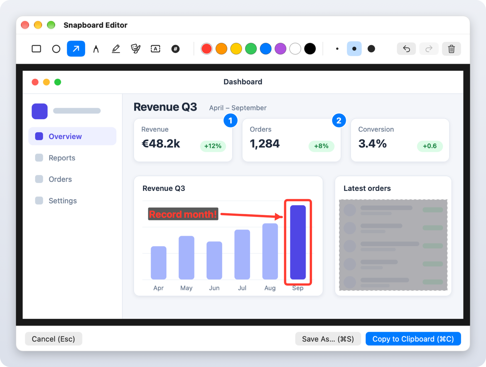
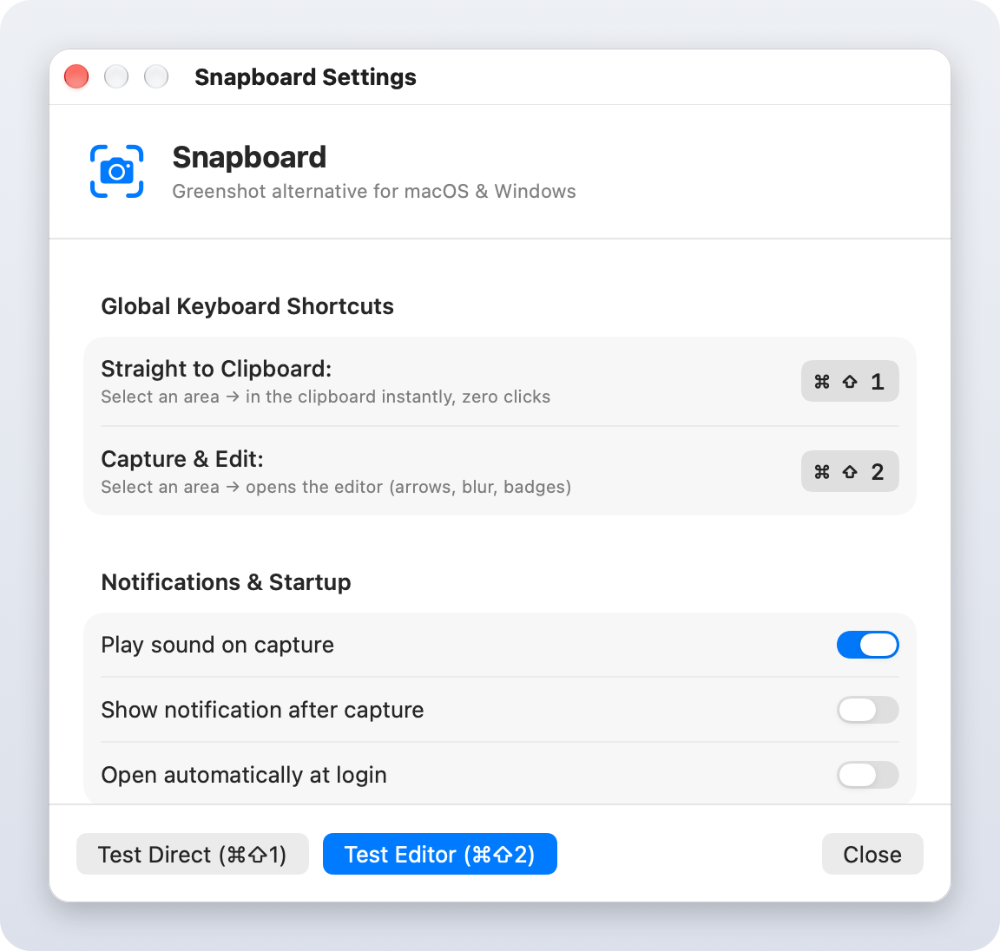

# Snapboard 📸⚡

[](https://github.com/leonatwork/snapboard/actions/workflows/build.yml)
[](https://github.com/leonatwork/snapboard/releases)
[](LICENSE)
[]()
[](https://github.com/search?q=topic%3Ai-love-macos-but-i-miss-windows-features+user%3Aleonatwork&type=repositories)

> The lightweight, privacy-focused Greenshot alternative for **macOS** and **Windows**.
> Capture screen areas directly to your clipboard — **without saving unnecessary files to disk**.

*🇩🇪 [Deutsche Version](README.de.md)*

---

## 🧩 Part of the package

Snapboard is one of four tools in the package **[“I love macOS, but I miss some Windows features”](https://github.com/search?q=topic%3Ai-love-macos-but-i-miss-windows-features+user%3Aleonatwork&type=repositories)**:

| Tool | What it does | Download |
| :--- | :--- | :--- |
| [**Tappi**](https://github.com/leonatwork/Tappi) | Alt+Tab between windows, not apps | [Latest release](https://github.com/leonatwork/Tappi/releases/latest) |
| [**Klemmi**](https://github.com/leonatwork/Klemmi) | Clipboard history like Win+V, with the app each entry came from | [Latest release](https://github.com/leonatwork/Klemmi/releases/latest) |
| [**Snapline**](https://github.com/leonatwork/snapline) | Windows 11 Snap Layouts, Aero Snap and Snap Assist | [Latest release](https://github.com/leonatwork/snapline/releases/latest) |
| [**Snapboard**](https://github.com/leonatwork/snapboard) *(this tool)* | Snipping-Tool-style screenshots straight to the clipboard | [Latest release](https://github.com/leonatwork/snapboard/releases/latest) |

👉 Missing more than one of these? Download all four and bring your favourite Windows features to your Mac.

---

## 📥 Download & Installation

You can download Snapboard straight from GitHub and use it without touching a terminal:

| Platform | Download | Installation |
| :--- | :--- | :--- |
| 🍏 **macOS** (Apple Silicon & Intel) | [**Download Snapboard-macOS.zip**](https://github.com/leonatwork/snapboard/releases/latest/download/Snapboard-macOS.zip) | Unzip and drag `Snapboard.app` into your **Applications** folder |
| 🪟 **Windows** (x64) | [**Download Snapboard-Windows-x64.zip**](https://github.com/leonatwork/snapboard/releases/latest/download/Snapboard-Windows-x64.zip) | Unzip and double-click `Snapboard.exe` |

👉 All versions are also listed under [**GitHub Releases**](https://github.com/leonatwork/snapboard/releases).

### macOS: first launch and Gatekeeper

The macOS release is not notarized, so Gatekeeper may block the first launch. On **macOS 15 or later**:

1. Move `Snapboard.app` to Applications and try to open it once, then dismiss the warning.
2. Open **System Settings > Privacy & Security**, scroll to the security section and click **Open Anyway** (German: **„Dennoch öffnen“**) for Snapboard.
3. Confirm the prompt (and authenticate if asked), then open Snapboard.

### macOS: screen recording permission

Before each capture, Snapboard checks the screen recording permission. If it is missing, the capture does not start and a dialog explains how to grant it. Click **Open System Settings** to go directly to **Privacy & Security > Screen & System Audio Recording** (called **Screen Recording** on some macOS versions) and enable Snapboard. You may need to quit and reopen Snapboard afterward; then press `⌘⇧1` or `⌘⇧2` again.

Notifications are off by default. macOS only asks for notification permission when you enable **Show notification after capture** in Snapboard’s settings. If permission is denied, the switch turns off again. To enable it later, allow Snapboard under **System Settings > Notifications**, then turn the switch on again.

---

## 🖼️ Screenshots

<div align="center">
  <h3>Snapboard Editor: arrows, shapes, text, step badges & redaction (⌘ ⇧ 2 / Ctrl + Shift + 2)</h3>
  
  <br /><br />
  <h3>Settings: global shortcuts, sound, notifications & open at login</h3>
  
</div>

---

## ✨ Features

- ⚡ **Zero-click clipboard capture**: select an area and paste it straight into any app with `⌘ V` / `Ctrl + V`.
- 🎨 **Built-in annotation studio**:
  - ⭕ **Circles & ellipses**
  - ⬜ **Rectangles & frames**
  - ➡️ **Arrows**
  - ✏️ **Freehand pen**
  - 🖍️ **Highlighter** (semi-transparent)
  - 🌫️ **Redaction / pixelate**: obscure passwords, bank details, names and the like
  - 🔤 **Text boxes**
  - ① **Step counter (1, 2, 3…)**: auto-incrementing badges for walkthroughs
- 🛡️ **No disk clutter**: works entirely in memory — no temporary or leftover screenshot files.
- 🪶 **Native & lightweight**: sits quietly in the menu bar (macOS) or system tray (Windows).
- 🚀 **Launch at login**: one click to start with the system.
- 🌍 **10 languages**: English, German, French, Spanish, Italian, Portuguese (Brazil), Dutch, Japanese, Simplified Chinese and Korean. The macOS app follows your system language (the Windows app is currently German only).

---

## ⌨️ Shortcuts

### 🍎 macOS
| Shortcut | Mode | Action |
| :--- | :--- | :--- |
| **`⌘ + ⇧ + 1`** | **Direct capture** | Select an area → **straight to the clipboard** (zero clicks) |
| **`⌘ + ⇧ + 2`** | **Capture & edit** | Select an area → **opens the Snapboard editor** |
| `Space` | Window mode | Capture a specific window during selection |
| `ESC` | Cancel | Abort the capture without touching the clipboard |
| `⌘ + C` / `Enter` | Export (in editor) | Copy the edited image and close the editor |
| `⌘ + S` | Save as… | Optionally export as a PNG file |

### 🪟 Windows
| Shortcut | Mode | Action |
| :--- | :--- | :--- |
| **`Ctrl + Shift + 1`** | **Direct capture** | Select an area → **straight to the clipboard** (zero clicks) |
| **`Ctrl + Shift + 2`** | **Capture & edit** | Select an area → **opens the Snapboard editor** |
| `ESC` | Cancel | Abort the capture |
| `Ctrl + C` | Export (in editor) | Copy the edited image and close the editor |
| `Ctrl + S` | Save as… | Optionally export as a PNG file |

---

## 🛠️ Building from source

### 🍎 macOS
```bash
# one-click install into /Applications
./scripts/install.sh

# or build manually
./scripts/build_app.sh
```

### 🪟 Windows
```cmd
cd windows
dotnet publish Snapboard.Windows\Snapboard.Windows.csproj -c Release -r win-x64 --self-contained false -p:PublishSingleFile=true -o bin\Release
```

---

## 🤝 Contributing

Bug reports and pull requests are welcome — see [CONTRIBUTING.md](CONTRIBUTING.md).

---

## 💎 Open source & premium

Snapboard is and stays open source under the MIT License. Everything in this repository
remains free to use, modify and share.

Two ways to support the project are planned:

- **Sponsoring**: voluntary support for ongoing development. The link follows here as soon
  as it is set up.
- **Premium add-ons**: optional extra features, offered as a separate paid package. They
  build on the free core and never take features away from it.

---

## 📄 License

Released under the [MIT License](LICENSE).
